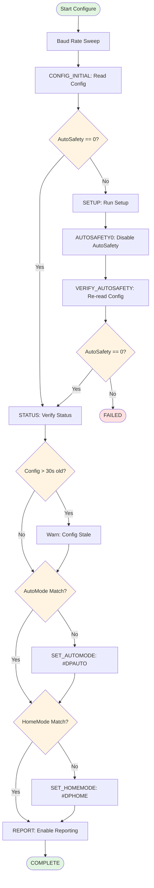

# ros2_roamadome

A ROS2 hardware interface for the [Roam-A-Dome](https://github.com/reeltwo/DomeControlFirmware) controller, which manages dome positioning for R2-D2 models and similar projects.

## Overview

This package provides a ROS2 control hardware interface that integrates with the Roam-A-Dome controller firmware. It exposes the dome joint through standard ROS2 hardware interfaces, allowing controllers and motion planning nodes to command and monitor dome position and velocity.

### Key Features

- **Hardware Interface**: Implements `ActuatorInterface` for ROS2 control framework
- **Startup State Machine**: Configure lifecycle uses a read-driven command/probe sequence
- **State Interfaces**: Exposes dome joint position and velocity feedback
- **Command Interfaces**: Accepts position and velocity commands for dome movement
- **Pluginlib-based**: Loadable as a ROS2 controller plugin

## Hardware Background

The [Roam-A-Dome](https://github.com/reeltwo/DomeControlFirmware) (RDH) is an Arduino-based controller board for dome positioning systems. It supports:

- **Multiple Board Variants**: Arduino Mega, ESP32, ESP32S2, ESP32S3 with optional LCD displays
- **Controls**: Motor speed, acceleration/deceleration ramping, homing, and autonomous movement modes
- **Communication**: 
  - Serial packet protocol for command/control
  - PWM input/output support
  - WiFi support (ESP32 variants)
  - Droid Remote support for app-based control
- **Positioning**: Absolute and relative dome rotation with configurable speed profiles

For complete hardware documentation, see the [DomeControlFirmware repository](https://github.com/reeltwo/DomeControlFirmware).

## Package Structure

```
ros2_roamadome/
├── src/
│   ├── roamadome_control.cpp      # Hardware interface implementation
│   └── roamadome_control_node.cpp # Standalone node (if applicable)
├── ros2_roamadome/bench/
│   ├── analysis.py                # Bench analysis, pure Python (no ROS imports)
│   ├── control.py                 # Node safety logic: sweep claim, drive gate, validation
│   └── node.py                    # roamadome_bench node
├── scripts/
│   ├── roamadome_bench            # ros2 run entry point for the node
│   └── roamadome_bench_report     # Offline analysis of a run directory
├── include/ros2_roamadome/
│   ├── roamadome_control.hpp      # Hardware interface header
│   └── visibility_control.h       # Symbol visibility macros
├── robot_hardware.xml             # Hardware interface plugin description
├── CMakeLists.txt
├── package.xml
└── README.md
```

## Interfaces

### State Interfaces

The controller exports the following state interfaces for the `dome_joint`:

| Interface | Description |
|-----------|-------------|
| `dome_joint/position` | Current dome position in radians (0-2π) |
| `dome_joint/velocity` | Dome angular velocity in rad/s, estimated from the firmware position stream (see [Velocity estimate and telemetry](#velocity-estimate-and-telemetry)). NaN until the regression window is populated after activation. |

### Command Interfaces

The controller accepts the following command interfaces for the `dome_joint`:

| Interface | Description |
|-----------|-------------|
| `dome_joint/position` | Desired dome position in radians |
| `dome_joint/velocity` | Desired dome angular velocity in rad/s |

### Velocity estimate and telemetry

The firmware reports only an integer, home-relative angle (`DOME POSITION: <n>`)
at the interval requested by `#DPREPORT`. The hardware interface unwraps that
stream into a continuous angle (shortest signed step between successive
readings) and estimates velocity as the least-squares slope of unwrapped angle
against host receive time over the trailing `velocity_window_s` seconds. The
estimate is NaN until the window holds at least four samples spanning at least
40% of the window. Adjacent samples are never differentiated directly: one
degree of quantisation at a 28 ms report interval would be 36°/s of noise per
sample. The implementation is the header-only `PositionTracker` in
`include/ros2_roamadome/position_tracker.hpp`.

With `publish_telemetry` set to `true`, every position report is also published
as `astromech_msgs/msg/DomeTelemetry` on `~/telemetry` of the hardware
component's node. The node is named after the `ros2_control` block in lower
case, so the `RoamADome` block publishes on `/roamadome/telemetry`:

| Field | Meaning |
|-------|---------|
| `header.stamp` | Host time when the read cycle consumed the report line, so quantised to the controller manager period |
| `position_deg` | Integer angle from the firmware, 0..359 |
| `position_rad` | The same angle in radians, [0, 2π) |
| `unwrapped_rad` | Continuous angle since activation |
| `velocity_rad_s` | Regression velocity estimate, NaN until the window is populated |
| `commanded_percent` | Last `:DPR` percentage sent in any mode, 0 when none |
| `command_mode` | 0 idle, 1 position, 2 velocity, 3 bench |
| `sequence` | Increments per report line since activation |

The topic is intended for the bench diagnostics described in
[docs/dome_diagnostics_plan.md](docs/dome_diagnostics_plan.md) and is off by default.
Because the serial port is polled from `read()`, the stamp resolution is one
controller manager cycle (33 ms at 30 Hz) and two report lines that arrive in
the same cycle get stamps only microseconds apart; the regression velocity
tolerates this, but a per-sample timing analysis should not assume evenly
spaced samples.
`read()` drains everything the port holds each cycle (up to 16 KB), so a config
dump or status poll never delays the position reports queued behind it by more
than the cycle it arrives in, and the periodic `#DPCONFIG` refresh is deferred
while the dome is moving (`config_refresh_interval_ms`).

**Plausibility gate.** With `max_plausible_deg_s` set (0, the default, turns it off) a report
whose step from the last accepted one exceeds `max_plausible_deg_s x dt + 2 deg` is held
rather than applied; `dt` is never taken shorter than the report interval, and a step across
0 deg gets 10 deg more because the controller skips 359 to 2 deg there. The next report
decides: plausible from the last accepted one, the held report was a sensor-ring misread
and is dropped (WARN `Rejected implausible position report`); plausible only from the held
one, the dome really moved and both are applied in order (INFO); plausible from neither,
the held one is dropped and the new one held. A real report is therefore delayed by one
report, and lost only if the one after it disagrees with it; a single misread no longer
shifts `unwrapped_rad` by a turn (the failure seen on the old sensor plate). If three
reports in a row disagree with the accepted history (a dome faster than
`max_plausible_deg_s`, whose every step is a little over the allowance), the newest is
accepted as a **resync** so the position can never freeze; set the limit well above the
real top speed. `position_deg`, `position_rad`, `unwrapped_rad`, `velocity_rad_s` and
`sequence` only ever carry accepted reports; a held report that is later confirmed is
published with the stamp of the cycle that confirmed it. The gate's counters are on the
`roamadome: sensor` diagnostic (`reports_held`, `reports_rejected`, `jumps_confirmed`,
`gate_resyncs`), which is WARN for 10 s after a rejection, and the bench node folds their
change over a sensor sweep into `suggested_pass` (`plugin_gate` in `sensor_sweep.json`),
since a misread the gate dropped never reaches the telemetry the sweep scores. Set it to
1.5 x the speed sweep's measured maximum (the `r2_bringup` URDF value is in
[docs/calibration_findings.md](docs/calibration_findings.md)). Implementation:
`ReportPlausibilityGate` in `include/ros2_roamadome/report_plausibility_gate.hpp`.

### Bench mode

With the hardware parameter `enable_bench_mode` set to `true` the hardware node offers
`~/bench/drive` (`astromech_msgs/srv/DomeBenchDrive`, request `int8 percent`, -100..100,
0 stops), a raw rotate service for bench diagnostics (docs/dome_diagnostics_plan.md). With
the parameter `false` (the default) the service does not exist.

- **Raw drive.** The percentage is sent as `:DPR<p>` and is subject to the firmware's own
  `MinSpeed` (below it the dome stops), `SpeedTarget` (clamp) and `MaxSpeed` (scale), exactly
  as for the velocity controller (plan section 2.3). Read the values from `device.*`.
- **Heartbeat.** A drive is kept alive by calling the service again. The service only records
  the request; the `write()` loop sends `:DPR<p>` when the percent differs from the last one
  sent (an identical repeat call sends nothing but refreshes the heartbeat). If no call
  arrives within `bench_heartbeat_timeout_ms` while the last sent percent is non-zero, the
  interface logs a WARN and sends `:DPR0`.
- **Gating.** The call is rejected (`success: false` with a message) unless the interface is
  active, the serial port is open and no controller holds the command interfaces
  (command mode IDLE), so it can never fight `dome_controller`. Starting a controller while a
  bench drive is active sends `:DPR0` first and clears the bench state, as does deactivation.
- **Telemetry.** While a bench drive is active `~/telemetry` reports `command_mode` 3
  (`COMMAND_MODE_BENCH`) and the sent percent in `commanded_percent`; it returns to 0 when
  the drive stops. Settings writes are refused while `commanded_percent` is non-zero.
- **Bench move.** `~/bench/move` (`astromech_msgs/srv/DomeBenchMove`, request
  `uint16 target_deg`, 0..359, and `uint8 speed_percent`, 0..100) sends one absolute,
  home-relative `:DPA<target>` for the position sweep. A non-zero `speed_percent` is sent as
  a per-move speed, `:DPA<target>,<percent>` (the firmware floors it at `MinSpeed` and
  restores `SpeedTarget` when the move ends); 0 uses `position_move_speed_percent` if set,
  else plain `:DPA<target>`; above 100 is rejected. The firmware runs the move to completion on its own (`REACHED TARGET`, or
  its own position timeout) and **the host cannot cancel it**: `:DPR0` does not clear the
  firmware's target mode, and a non-zero `:DPR` only overrides it while non-zero (at `:DPR0`
  the firmware resumes the move), so a non-zero drive is refused while a move is claimed and
  a move is refused while a drive is active. The same gating as the drive applies (active,
  port open, no controller, no settings write in flight), the claim is kept alive by
  repeating the call (an identical target and speed refreshes the heartbeat without re-sending; a new
  target is sent), and `bench/drive` with percent 0 releases it; do that once the dome is at
  rest. If the heartbeat expires while a move is claimed the claim is released with a WARN
  and the firmware finishes the move. `command_mode` is 3 while the claim is held,
  `commanded_percent` stays 0 (a move is not a percent), and settings writes are refused.

Safety: the firmware has no watchdog in continuous rotation. The heartbeat only protects
while this process is alive. If the process is killed (SIGKILL, crash, power loss to the
host) the dome keeps turning at the last `:DPR` value; only a normal `on_deactivate` (which
sends `:DPR0`) or a manual stop will halt it. Keep a human at the robot and the dome clear.

### Bench node

`roamadome_bench` (Python, `ros2_roamadome/bench/`) runs the two bench diagnostics of
[docs/dome_diagnostics_plan.md](docs/dome_diagnostics_plan.md) through a bench-enabled
hardware node: a **sensor sweep** that spins the dome at several percentages in both
directions and scores every position report for jumps, reversals and stalls (plan 7.2), and a
**speed sweep** that measures steady-state velocity per percentage, finds the minimum moving
percentage and fits `omega = k * (p - p0)` per direction (plan 7.3). A third, the
**position sweep**, measures the stopping-distance curve (steady percent, then 0, travel to
rest) and a set of firmware position moves (`:DPA`) at the current `device.*` settings, for
the position-move tuning in step (g) of
[Re-tuning the velocity mapping](#re-tuning-the-velocity-mapping-when-the-dome-changes).

Launch it with the robot (`dome_bench:=true` also skips `dome_controller` and the dome teleop):

```bash
ros2 launch r2_bringup launch_robot.launch.py dome_bench:=true
```

or on its own against any hardware node that has `enable_bench_mode` and `publish_telemetry`
set and no controller claiming the dome:

```bash
ros2 run ros2_roamadome roamadome_bench --ros-args -p output_dir:=~/dome_bench
ros2 service call /roamadome_bench/start_sensor_sweep std_srvs/srv/Trigger
ros2 topic echo /roamadome_bench/status
ros2 service call /roamadome_bench/abort std_srvs/srv/Trigger
```

The node finds the hardware node by name through the `hardware_node` parameter (default
`roamadome`, the lower-cased `ros2_control` block name), not by sharing its namespace as plan
5.4 suggests: the hardware node's name comes from the URDF, so a parameter is simpler than
pushing the bench node into a matching namespace. It uses `<hardware_node>/telemetry`,
`<hardware_node>/bench/drive`, `<hardware_node>/bench/move` (position sweep only) and
`<hardware_node>/{get,set}_parameters`.

Parameters (read when a sweep starts, except `hardware_node` and `heartbeat_period_s`, which
are read at startup and cannot be changed while the node runs). Invalid values are rejected,
not corrected: at startup the node exits with an error listing them, and a later
`ros2 param set` with an invalid value fails. Percent lists must be integers in 1..100,
strictly ascending without duplicates; settle times must be >= 0; durations and thresholds
> 0; `speed_sweep.min_measure_s` <= `speed_sweep.max_measure_s`.

| Parameter | Default | Meaning |
|-----------|---------|---------|
| `hardware_node` | `roamadome` | Hardware node name (a leading `/` is added if missing) |
| `output_dir` | `~/dome_bench` | One subdirectory per run, named `<YYYYmmdd-HHMMSS>-<sweep>` |
| `heartbeat_period_s` | `0.5` | Re-send the current percent this often; must be in (0, 1.0] s (the plugin stops after `bench_heartbeat_timeout_ms`, 1.5 s by default) |
| `velocity_window_s` | `0.5` | Regression window for the per-sample velocity in the analysis (same rule as the plugin) |
| `sensor_sweep.percents` | `[20, 35, 50, 75, 100]` | Run lowest first, each `+p` then `-p` |
| `sensor_sweep.settle_s` | `2.0` | Settle before the measure phase (addition to plan 5.4) |
| `sensor_sweep.duration_s` | `30.0` | Measure phase per percent per direction |
| `sensor_sweep.max_plausible_deg_s` | `720.0` | Jump threshold; replaced by 1.5 x the measured maximum of a completed speed sweep in `output_dir` that used the same `raw_motor` and moved at or above the sensor sweep's highest percent |
| `sensor_sweep.wrap_allowance_deg` | `10.0` | Extra allowance for a step across 0 deg, where the controller skips 359 to 2 deg (every 0-crossing step is about 9 deg longer than the dome moved); applies to the jump scoring of every sweep, `>= 0` |
| `speed_sweep.percents` | `[10, 15, 20, 25, 30, 40, 50, 60, 70, 80, 90, 100]` | Ascending, each `+p` then `-p` |
| `speed_sweep.settle_s` | `2.0` | Wait after each command before measuring |
| `speed_sweep.min_measure_s` | `4.0` | Measure for max(this, one revolution at the observed speed) ... |
| `speed_sweep.max_measure_s` | `30.0` | ... capped here (addition to plan 5.4, which fixes 30 s) |
| `speed_sweep.stall_deg_s` | `3.0` | Stalled when the average speed over the last `stall_s` is below this; used by both sweeps |
| `speed_sweep.stall_s` | `2.0` | |
| `speed_sweep.raw_motor` | `true` | For the sensor and speed sweeps, temporarily set `device.max_speed` 100, `device.speed_target` 100, `device.scaling` false; the position sweep always runs at the current settings |
| `position_sweep.stop_percents` | `[35, 50, 70, 100]` | Stopping-distance curve: each `+p` then `-p`, ascending |
| `position_sweep.stop_run_s` | `5.0` | Steady run before the stop (the dome's response time is about 1.5 s) |
| `position_sweep.moves_deg` | `[150, -150, 40, -40, 90, -90, 20, -20, 120, -120, 60, -60]` | Firmware moves, each relative to the angle at its start, non-zero integers in -359..359 |
| `position_sweep.settle_s` | `1.2` | A step is at rest once the reported angle has not changed for this long |
| `position_sweep.move_timeout_s` | `12.0` | A move not at rest by then is recorded as `timeout` (the firmware's own `device.timeout` is 5 s without dome movement) |
| `position_sweep.move_speed_percent` | `0` | Per-move speed for the position sweep's firmware moves, 0..100, sent as `:DPA<deg>,<percent>`; 0 uses the firmware's `SpeedTarget` (or the plugin's `position_move_speed_percent`). Recorded as `speed_percent` in each move step and `move_speed_percent` in `position_sweep.json` |
| `position_sweep.stopped_deg_s` | `5.0` | Speed below which the dome counts as stopped for the stop-time and settle-time clocks (analysis) |

Services and topics on the bench node:

| Name | Type | Notes |
|------|------|-------|
| `~/start_sensor_sweep` | `std_srvs/Trigger` | Rejected if a sweep runs or is starting (the slot is claimed atomically), telemetry is not flowing, the hardware is not idle (`command_mode` 0, `commanded_percent` 0) or a hardware service is missing |
| `~/start_speed_sweep` | `std_srvs/Trigger` | Same checks |
| `~/start_position_sweep` | `std_srvs/Trigger` | Same checks, plus `bench/move` must be available. Runs the stop curve then the moves at the current `device.*` settings (nothing is written); each move starts from the angle the dome rests at |
| `~/abort` | `std_srvs/Trigger` | Returns at once; the worker stops the dome, restores settings and writes partial results |
| `~/status` | `std_msgs/String` | JSON at 2 Hz: state, sweep, run directory, phase, step, percent, direction, elapsed, counts so far, last result |

Every sweep follows the same lifecycle: save `device.max_speed`, `min_speed`, `speed_target`
and `scaling` to `settings_before.json` (with the `ros2 param set` commands that restore them);
with `raw_motor`, write the raw settings at standstill and read each back (a value already set
is not written again, since every write goes to flash). The plugin accepts a parameter write
before the firmware acks it, so the read-back only confirms the ROS value. The node therefore
also waits (up to 10 s) for the firmware acks the plugin reports on `/diagnostics`
(`roamadome: motion` values `settings_writes_pending`, `settings_acks`,
`settings_ack_timeouts`): nothing pending, the ack count advanced by the number of writes
issued (`Unchanged` counts as an ack) and no ack timeout. If that fails the sweep ends with an
error before the dome moves. The first drive is also retried for up to 12 s while the plugin
rejects it because a settings write is in flight; acceptance only means no write is queued or
waiting any more (an ack timeout clears it too), not that the firmware acked. Then the steps
run. Each step commands its
percent, settles, measures, then commands 0 and waits for standstill (telemetry
`commanded_percent` 0 and |velocity| below `stall_deg_s`, or 5 s) before the next one, so
every step starts from rest. The bench node does its own stall detection, because the
firmware has no watchdog in continuous rotation: a stalled step is stopped at once and the
sweep moves on. The speed sweep then binary-searches each direction between the highest
stalled and the lowest moving percent to 2 % for `min_percent`. On completion, `~/abort`, an
exception, SIGINT or SIGTERM the node commands 0 (from then on it refuses to send any non-zero
percent and the heartbeat only sends 0), waits for standstill, restores the saved settings
that differ, waits for the firmware acks as above (status phase `restoring settings`), reads
the settings back into `settings_after.json` and writes the results. If the restore is not
confirmed it logs `settings restore NOT confirmed by firmware; check device.* and
settings_before.json` at ERROR and records `settings_restored: false`. A drive-service
rejection, a heartbeat call failure, a controller taking the dome or more than 1 s without
telemetry aborts the sweep. A second SIGINT exits without waiting for the restore (it still
sends 0).

Output files in each run directory:

| File | Contents |
|------|----------|
| `settings_before.json` | Saved settings, context (`inverted`, `home_pos`, ...), restore commands |
| `settings_after.json` | Settings read back after the restore, the restore writes issued, `ros_matches_before` (the ROS parameters equal the saved values), `firmware_acked` (true only if the firmware acked every restore write with no ack timeout; `null` if the plugin does not publish the counters, false otherwise) and `ack_timeouts_during_restore` |
| `samples.csv` | One row per telemetry message during a step: `t_host,seq,position_deg,unwrapped_rad,velocity_rad_s,commanded_percent,direction,step_index,phase` (plan 5.5); `direction` is the sign of the commanded percent, `phase` is `settle` or `measure`. Written as it arrives |
| `run.json` | Sweep type, status (`running`, `complete`, `aborted`, `error`) and reason, the analysis config, the step list, settings and counts |
| `sensor_sweep.json` | Per step: samples, mean and standard deviation of velocity over the measure phase, jumps (with start angle, change, interval, percent), reversals, stalls; the 10 degree jump start histogram; totals and `suggested_pass` (no jumps and no reversals) |
| `speed_sweep.json` | Per step table; per direction (`positive_percent`, `negative_percent`): fit `k`, `p0`, R squared, `omega_max_rad_s` at 100 %, `min_percent`, velocity at `min_percent`; asymmetry ratio; recommended `max_speed_rad_per_sec` (the lower of the two maxima); the phase 7 `velocity_map` parameters keyed by velocity sign |
| `position_sweep.json` | `settings` (the `device.*` the sweep ran at); `stop_curve.steps` with the speed just before the stop (slope over the 0.3 s before the first sample stamped `commanded_percent` 0), `stop_distance_deg` (unwrapped travel from that sample to rest) and `stop_time_s`, and `fit` (`stop_distance_deg = slope [s] x speed + intercept [deg]`, overall and per direction); `moves.steps` with `rest_error_deg` (final angle minus target, signed), `furthest_past_target_deg` (negative: never reached), `peak_deg_s`, `settle_s` from the move command, `arrival_deg_s` on entering the fudge band, and the firmware's verdict from `/diagnostics` (`position_timeouts`, `reached_target_deg`); `moves` totals: completed, timed out, never reached, `rest_error_deg` max and mean per direction, `overshoot_max_deg`, the arrival speed range and the coast it implies by the fit |

Notes on the analysis (`ros2_roamadome/bench/analysis.py`, no ROS imports):

- The direction of angle change for a positive percent is measured, not assumed
  (`angle_sign_for_positive_percent`). Reversals are scored against this measured sign, and
  the phase 7 parameters give the `percent_sign` that produces a positive (angle-increasing)
  velocity.
- Two report lines read in the same controller cycle are stamped only tens of microseconds
  apart, although the firmware sent them 28 ms apart;
  scored with that interval every normal move would look like a jump. Pairs closer than 5 ms
  (`same_cycle_dt_s` in the config) are therefore not scored for jumps; their count is
  reported as `same_cycle_pairs`, and the largest gap between reports as `max_gap_s`.
- Reversals and stalls count only at percentages at or above the known minimum: the speed
  sweep's `min_percent` when its result is used, otherwise the firmware `MinSpeed`.
- Velocity per step is the least-squares slope over the measure phase; the mean and standard
  deviation are of the windowed per-sample estimates. The fit uses the slope.

Re-run the analysis offline (plain Python, no ROS needed beyond the installed package):

```bash
ros2 run ros2_roamadome roamadome_bench_report ~/dome_bench/20261014-210000-speed
ros2 run ros2_roamadome roamadome_bench_report RUN_DIR --check          # exit 1 if it differs from the saved JSON
ros2 run ros2_roamadome roamadome_bench_report RUN_DIR --set max_plausible_deg_s=400
```

**If the bench node is killed with SIGKILL** (or crashes) during a sweep, the dome stops
through the plugin's heartbeat: no drive call arrives, so the hardware interface logs
`Bench drive stopped (heartbeat expired); sent :DPR0` within `bench_heartbeat_timeout_ms`.
The settings are **not** restored. Restore them by hand from the run's `settings_before.json`
(it lists the commands), for example:

```bash
ros2 param set /roamadome device.max_speed 80
ros2 param set /roamadome device.speed_target 100
ros2 param set /roamadome device.scaling false
ros2 param get /roamadome device.max_speed
```

The same applies when the whole launch is stopped with Ctrl-C during a sweep: the controller
manager deactivates the hardware (which sends `:DPR0`) at the same time, so the bench node
cannot write settings any more. Abort the sweep first and wait for `~/status` to report `idle`.

### Re-tuning the velocity mapping when the dome changes

The velocity mapping (rad/s to `:DPR` percent) and the position-move settings are measurements
of one mechanical setup. Repeat this procedure whenever that setup changes: dome shell mounted
or removed, added weight, bearing or drive-train friction changed (including a realignment or
lubrication), a new motor or motor controller, or a change to the firmware's `MaxSpeed`,
`MinSpeed`, `SpeedTarget` or `Scaling`.

The values configured today, the firmware settings they were measured at, and everything the
bench robot taught us along the way are in
[docs/calibration_findings.md](docs/calibration_findings.md); each run's own report is in
[docs/bench_results/](docs/bench_results/).

**(a) Prerequisites and safety.**

- A human at the robot for the whole session, the dome clear of cables, tools and hands. A
  sweep spins the dome continuously up to 100 % motor output in both directions, and the
  velocity path has no watchdog: a stalled host cannot stop the dome. Know the stops that do
  not depend on the ROS graph: SIGINT to the controller manager (its deactivation sends
  `:DPR0`), or `:DPR0` over the serial port.
- A bench-enabled hardware node with telemetry and **no controller holding the dome**: either
  the robot launch with `dome_bench:=true` (it sets `enable_bench_mode` and `publish_telemetry`,
  skips the `dome_controller` spawner and the dome teleop, and starts `roamadome_bench`):

  ```bash
  ros2 launch r2_bringup launch_robot.launch.py dome_bench:=true
  ```

  or a stand-alone stack with only the RoamADome hardware (the same two parameters set) plus
  `ros2 run ros2_roamadome roamadome_bench --ros-args -p output_dir:=~/dome_bench`.
  `ros2 control list_controllers` must not list `dome_controller` as active.
- Note the firmware settings first (`ros2 param get /roamadome device.max_speed`, and
  `min_speed`, `speed_target`, `scaling`). They are part of the calibration state (see (e)).
  The bench node never writes `inverted`, `home_pos` or `auto_safety`; neither should you.
- Let the dome run for a few minutes before the sweep you will keep: the first run of a
  session comes out a few percent slower while the drive warms up.

**(b) Run the sweeps.** Speed sweep first, so the sensor sweep takes its jump threshold
(1.5 x the measured maximum) and its minimum percentages from it. Start one sweep at a time
and wait for `"state": "idle"` on the status topic before the next:

```bash
ros2 service call /roamadome_bench/start_speed_sweep std_srvs/srv/Trigger
ros2 topic echo /roamadome_bench/status          # about 3 min; wait for "state": "idle"
ros2 service call /roamadome_bench/start_sensor_sweep std_srvs/srv/Trigger
ros2 topic echo /roamadome_bench/status          # about 5 min
```

Abort at any time with `ros2 service call /roamadome_bench/abort std_srvs/srv/Trigger`. Each
sweep writes `<output_dir>/<YYYYmmdd-HHMMSS>-speed/` and `...-sensor/` (`output_dir` defaults to
`~/dome_bench`), with `speed_sweep.json` / `sensor_sweep.json`, `samples.csv`, `run.json` and
the settings files ([Bench node](#bench-node)). Then:

```bash
ros2 param get /roamadome device.max_speed     # back at the value noted in (a), likewise speed_target, scaling
ros2 run ros2_roamadome roamadome_bench_report ~/dome_bench/<run>-speed --check
ros2 run ros2_roamadome roamadome_bench_report ~/dome_bench/<run>-sensor --check
```

A run passes when:

- `run.json` has `"status": "complete"` and `"settings_restored": true`, and
  `settings_after.json` has `"firmware_acked": true` (if not, restore by hand from
  `settings_before.json`, see above);
- speed sweep: `angle_sign_consistent` true; in both `directions`, a 100 % step moved,
  `min_percent_bracketed` true, `stalled_above_min_percent` and `wrong_direction_steps` empty,
  and `fit.r_squared` about 0.99;
- sensor sweep: `config.max_plausible_source` names the speed sweep just run, and
  `suggested_pass` true (no jumps, no reversals, no plugin-gate rejections). Jumps that cluster
  in the `jump_start_histogram` point at a misaligned sensor track: fix the mechanics and
  re-run the sensor sweep. The one step the controller cannot report cleanly, the crossing of
  the 355 to 4 deg dead zone near 0, is covered by `sensor_sweep.wrap_allowance_deg` and does
  not count;
- `--check` exits 0.

The speed sweep runs with `speed_sweep.raw_motor` true by default (MaxSpeed 100, SpeedTarget
100, Scaling off during the sweep), but the plugin drives the dome at the operating settings,
so always run a second speed sweep at the operating settings and compare:

```bash
ros2 param set /roamadome_bench speed_sweep.raw_motor false
ros2 service call /roamadome_bench/start_speed_sweep std_srvs/srv/Trigger
```

Rule: take `k` and `p0` from the operating-settings run (that is what the plugin drives
through); per direction, use the **larger** `min_percent` of the two runs; for
`max_speed_rad_per_sec`, use the lowest of the measured 100 % steps.

Write the results up next to the earlier ones in `docs/bench_results/` (report plus the result
JSON files, not the CSVs), with the dome configuration in the title, and update
[docs/calibration_findings.md](docs/calibration_findings.md).

**(c) Map the speed result onto the hardware parameters.** The `phase7` block of
`speed_sweep.json` is keyed by the sign of the **joint** velocity (the reported angle's
direction, the same sign as `position` and `velocity_rad_s` in the telemetry):

```json
"phase7": {
  "positive_velocity": {"percent_sign": -1, "k_percent_per_rad_s": ..., "p0_percent": ..., "min_percent": ...},
  "negative_velocity": {"percent_sign": 1,  "k_percent_per_rad_s": ..., "p0_percent": ..., "min_percent": ...},
  "max_speed_rad_per_sec": ...
}
```

| Result field | Hardware parameter | Meaning |
|--------------|--------------------|---------|
| `phase7.<dir>.k_percent_per_rad_s` | `velocity_map.<dir>.k_percent_per_rad_s` | Percent per rad/s above `p0` |
| `phase7.<dir>.p0_percent` | `velocity_map.<dir>.p0_percent` | Percent at which the fitted speed reaches zero |
| `phase7.<dir>.min_percent` | `velocity_map.<dir>.min_percent` | Lowest percent that kept the dome moving (the larger of the two runs) |
| `phase7.<dir>.percent_sign` | `velocity_map.<dir>.percent_sign` | Sign of the `:DPR` percent that produces that joint direction |
| `directions.*.omega_max_measured_rad_s` (the lower of the two) | `max_speed_rad_per_sec` | Measured rate at 100 % |

`<dir>` is `positive` / `negative` in the parameter names and `positive_velocity` /
`negative_velocity` in the JSON. For `max_speed_rad_per_sec` use the measured 100 % values,
not `phase7.max_speed_rad_per_sec`, which is the lower of the two fit extrapolations
`(100 - p0) / k`; it only sets the default `k`. If a re-run reports the opposite
`angle_sign_for_positive_percent` from last time, something in the wiring or the `Inverted`
setting changed: find out what before configuring anything.

Set the values in the RoamADome block of `src/r2_bringup/urdf/ros2_control.xacro`, outside the
`dome_bench` condition so they apply to normal launches:

```xml
<ros2_control name="RoamADome" type="actuator">
    <hardware>
        <plugin>ros2_roamadome/RoamadomeControl</plugin>
        <param name="serial_port">...</param>
        <param name="max_speed_rad_per_sec">MEASURED_RATE_AT_100</param>
        <param name="velocity_map.positive.k_percent_per_rad_s">K</param>
        <param name="velocity_map.positive.p0_percent">P0</param>
        <param name="velocity_map.positive.min_percent">MIN</param>
        <param name="velocity_map.positive.percent_sign">-1</param>
        <!-- and the same four under velocity_map.negative. -->
        ...
```

Then rebuild and relaunch:

```bash
cd ~/r2_ws
colcon build --symlink-install --packages-select r2_bringup
source install/setup.bash
ros2 launch r2_bringup launch_robot.launch.py dome_bench:=true   # for the check in (d)
```

**(d) Acceptance check.** Points: +-1.5 and +-3.0 rad/s, telemetry velocity within 10 % of
the command in both directions after settling. (The plan's 0.5 rad/s maps below the floor; with
`velocity_map.below_minimum` `zero`, the default, the plugin sends `:DPR0` there by design.)
Use the `dome_bench:=true` launch (telemetry on, no `dome_controller`), make sure no sweep
runs, then load the velocity controller by hand; the bench drive is refused while it holds the
dome:

```bash
ros2 control load_controller --set-state active dome_controller
ros2 topic pub -r 10 /dome_controller/commands std_msgs/msg/Float64MultiArray "{data: [1.5]}"
# second terminal, after about 2 s of settling: mean and sample count over 5 s
timeout 5 ros2 topic echo /roamadome/telemetry --field velocity_rad_s \
  | grep -E '^-?[0-9]' | awk '{s += $1; n++} END {print s / n, n}'
# Ctrl-C the publisher, stop the dome, repeat with -1.5, 3.0 and -3.0
ros2 topic pub --once /dome_controller/commands std_msgs/msg/Float64MultiArray "{data: [0.0]}"
```

Pass: the mean is within 10 % of the command (1.35 to 1.65 for +1.5, -1.65 to -1.35 for -1.5,
and likewise for +-3.0). Expect scatter within a few points of the floor, where the dome's
friction sets the speed; from about 40 % up the fit holds within 5 %. Then
`ros2 topic pub --once ... "{data: [0.0]}"`, `ros2 control set_controller_state dome_controller
inactive` and `ros2 control unload_controller dome_controller`, and relaunch without
`dome_bench` for normal use. Record the points used and the result in the bench report.
`~/dome_bench/scripts/phase7_validate*.sh` and `phase7_analyze.py` on the bench robot run this
on the stand-alone stack.

**(e) The firmware settings are part of the calibration.** `MaxSpeed`, `SpeedTarget`,
`MinSpeed` and `Scaling` all sit between the percent the plugin sends and the motor
(`MinSpeed` zeroes small percentages, `SpeedTarget` clamps, `Scaling` adds ramps; `MaxSpeed`
does not scale `:DPR` on this firmware). The fit is valid only for the values it was measured
with, which are recorded in each run's `settings_before.json`. Changing any of them, through
`device.*`, the firmware menu or `#DP` commands, invalidates the fit: re-run (b) to (d). Keep
`SpeedTarget` at 100: it caps `:DPR`, so a lower value limits the velocity controller, and it
does not change the position moves (see the findings).

**(f) The velocity mapping in the plugin.** Per direction of rotation (the sign of the joint
velocity `v`) the plugin computes `p = round(p0_percent + |v| * k_percent_per_rad_s)`. If that
rounded `p` is below the direction's `min_percent` (an integer 0..100), `p` becomes 0
(`velocity_map.below_minimum` `zero`, the default, so the dome stops rather than stalls) or
`min_percent` (`minimum`). Then `p` is capped at 100 and sent as `:DPR<percent_sign * p>`.
`v` = 0 (or NaN) sends 0. `percent_sign` is the sign of the percent sent for that direction, so
a positive joint velocity command turns the joint positive; a controller or teleop scale must
not compensate for the motor's sign any more. With none of the `velocity_map.*` parameters set
the plugin keeps the old linear mapping `percent = velocity / max_speed_rad_per_sec * 100`
(rounded, clamped to +-100, sign passed through; within one percent of the old formula at exact
half-point inputs). `max_speed_rad_per_sec` keeps its name but now means the measured rate at
100 % and only sets the default `k` (`100 / max_speed_rad_per_sec`); with the fit, the clamp at
100 % comes from `k` and `p0`. The plugin refuses to start if the two `percent_sign` values are
equal (the motor sign is one physical fact), if a `velocity_map.*` name is unknown, or if
`min_percent` is not an integer; it warns when a direction has only some of its four keys. A
command is re-sent only when the mapped percent changes. The resolved map is logged at INFO when
the plugin starts.

**(g) Position-move tuning: `MinSpeed`, `DecelerationScale` and `Fudge`.** The firmware's
position move tapers the commanded percent from `SpeedTarget` down to the `MinSpeed` floor over
the last `DecelerationScale` degrees, then cuts the motor at the `Fudge` boundary; the dome
coasts from there (the motor driver has no ramp). So the rest error is the stopping distance at
the arrival speed minus the fudge, and the floor speed is what decides it. The bench node's
**position sweep** measures the stopping-distance curve and a set of moves in one run at the
current `device.*` settings (it writes nothing):

```bash
ros2 param set /roamadome device.min_speed 20          # candidate settings, each persists to flash
ros2 param set /roamadome device.deceleration_scale 250
ros2 param set /roamadome device.fudge 5
ros2 service call /roamadome_bench/start_position_sweep std_srvs/srv/Trigger
# then read position_sweep.json in the run directory: stop_curve.fit, moves.rest_error_deg,
# moves.end_reason, moves.firmware, moves.arrival_deg_s and moves.coast_from_arrival_deg
```

1. `DecelerationScale`: large enough that the dome has actually slowed to the floor speed
   before the fudge boundary (the maximum, 250, on a dome with a response time of about
   1.5 s). `SpeedTarget` does not change the accuracy once the taper is long enough.
2. `MinSpeed`: the lowest floor at which every move still completes. Lower it in steps of 5,
   running the position sweep and the operating-settings speed sweep at each (the script
   `~/dome_bench/scripts/run_minspeed_candidates.sh <outdir> <MinSpeed...>` does both and
   `minspeed_summary.py` tabulates them). It breaks when moves end with `no_motion`, `timeout`
   or a large negative rest error with no `REACHED TARGET` in `moves.firmware` (the approach
   stalls at the ring's tight spots), or when the speed sweep's step at that percent does not
   move. Set the multiple of 5 above the breaking value. The velocity map's `min_percent`
   follows from the speed sweep at that setting.
3. `Fudge`: the stopping distance at the floor arrival speed, read off the stop curve at
   `moves.arrival_deg_s`; the floor speed varies with dome angle, so set it at the middle of
   the range and check both directions at several end angles. Rest errors that are all of one
   sign and larger than the fudge mean the coast is longer than the fudge.

Run the position sweep again after any change to the dome's mass or friction, or to
`MinSpeed`, and the operating-settings speed sweep with it.

### Diagnostics

While active, the hardware interface publishes a `diagnostic_msgs/DiagnosticArray`
on the global `/diagnostics` topic at 1 Hz with three statuses, all carrying the
serial port path as `hardware_id`:

| Status | OK | WARN | ERROR |
|--------|----|------|-------|
| `roamadome: link` | Position reports flowing | No report yet, or none for 0.5 s | Serial port closed, or `READY` seen while active (the controller rebooted) |
| `roamadome: sensor` | Sensor error count steady | Count grew between the last two `#DPSTATUS` polls, or the plausibility gate rejected a report within the last 10 s | |
| `roamadome: motion` | No timeout outstanding | `ERROR: DOME POSITION TIMEOUT` more than 5 s ago and no `REACHED TARGET` / `REACHED HOME` since | `ERROR: DOME POSITION TIMEOUT` within the last 5 s |

Values include the report and poll counters, the firmware's sensor and packet
serial error counts, the plausibility gate's `reports_held`, `reports_rejected`,
`jumps_confirmed` and `last_rejection_age_s`, the last accepted `:DPR` percent, the last
target and home reached, position timeouts, out-of-range rejections and the current
command mode. `position_reporting_enabled` on `roamadome: link` is true once the
`#DPREPORT` ack has been seen **or any position report has arrived**, so it no longer
reads false for a whole session when the startup ack is missed.
`roamadome: motion` also reports the settings-write pipeline: `settings_writes_pending`
(ack-tracked `#DP...` writes queued, plus one waiting for its ack), `settings_acks`
(completed by `Write Settings` + `Updated` or by `Unchanged`) and `settings_ack_timeouts`
(abandoned after the 3 s ack timeout; such a write may not have reached flash). The counters
reset on activation; `on_deactivate` drops queued writes.

The firmware's own counters come from `#DPSTATUS`, which the interface queues
(followed by `#DPINVALID` to close the section) once on activation and then every
`status_poll_interval_ms`; set it to `0` to disable polling. The console lines the
firmware prints for accepted commands, finished moves, rejections and boot
(`ROTATE SPEED`, `ROTARY DEGREE`, `REACHED TARGET`, `REACHED HOME`,
`ERROR: DOME POSITION TIMEOUT`, `Out of range.`, `Unchanged`, `READY`, the
`#DPSETUP` output and the reporting acks) are recognised by
`classifyFirmwareLine()` in `include/ros2_roamadome/firmware_line_classifier.hpp`
and folded into the diagnostics state; a position timeout and a reboot are also
logged at WARN and ERROR respectively.

## Dependencies

- **ROS2 Dependencies**:
  - `hardware_interface`: Hardware abstraction layer
  - `controller_manager`: Manages lifecycle and plugins
  - `pluginlib`: Dynamic plugin loading
  - `rclcpp`: C++ ROS2 client library

## Building

Build the package using `colcon`:

```bash
cd ~/r2_ws
colcon build --packages-select ros2_roamadome
```

## Usage

### Hardware Configuration

To use this hardware interface, include it in your ROS2 hardware configuration URDF or YAML file. The hardware interface will be loaded by the controller manager as a pluginlib plugin.

Example configuration:

```yaml
hardware:
  - name: roamadome_control
    type: ros2_roamadome/RoamadomeControl
```

### Launching Controllers

Once the hardware interface is loaded, you can load controllers (e.g., a position controller) that interact with the dome joint:

```bash
ros2 control load_controller dome_position_controller
ros2 control set_controller_state dome_position_controller active
```

### Commanding the Dome

Commands can be published to controller topics or issued via the controller manager interface.

- **Position mode.** When a position controller claims the joint, the interface sets the
  command interface to the dome's current angle and sends nothing until the controller
  writes a different value (more than 0.01 rad away), so activating a controller no longer
  sends the dome to 0 deg. With `position_move_speed_percent` set (1..100) each move is sent
  as `:DPA<deg>,<percent>`, a per-move speed that leaves `SpeedTarget` (and so the velocity
  controller) untouched; 0 sends plain `:DPA<deg>`. A `NaN` command (a controller that writes `NaN`) sends nothing.
  In velocity mode the command starts at 0 and the first non-zero value is sent.
- **A firmware position move cannot be cancelled from the host.** `:DPA` hands the move to
  the firmware's target mode, and `:DPR0` (what the interface sends on a mode switch, a bench
  stop or deactivation) does not clear that mode: a non-zero `:DPR` overrides the move only
  while it is non-zero, and at `:DPR0` the firmware resumes it. A move therefore always ends
  by itself, at `REACHED TARGET` or at the firmware's `device.timeout` without dome movement.
  Switch controllers, or deactivate, when the dome is at rest. While such a move is
  outstanding (a `:DPA` sent and no `REACHED TARGET`, `REACHED HOME` or timeout seen yet)
  the interface refuses non-zero bench drives and settings writes, and logs a WARN when a
  controller starts.

## Setting up the Hardware Device

Before using this interface:

1. **Program the Roam-A-Dome**: Program the controller board with the DomeControlFirmware
2. **Serial Configuration**: Configure via serial commands (see firmware documentation)
3. **Homing**: Perform initial homing calibration either via serial, LCD menu, or hardware setup
4. **Connection**: Establish serial communication from ROS2 host to the controller

For detailed hardware setup instructions, see the [DomeControlFirmware README](https://github.com/reeltwo/DomeControlFirmware#readme).

## Serial Protocol

This interface communicates with the hardware via the Roam-A-Dome serial protocol.

### Configuration Parameters

The following parameters can be specified in your URDF/XACRO hardware description:

| Parameter | Type | Default | Description |
|-----------|------|---------|-------------|
| `serial_port` | string | *required* | Serial port device path (e.g., `/dev/ttyACM0`) |
| `serial_baud` | uint32 | `115200` | Serial baud rate |
| `max_speed_rad_per_sec` | double | `3.14` | Measured dome rate at 100 % in rad/s (default ~180°/s), must be > 0. It only sets the default of `velocity_map.*.k_percent_per_rad_s` (`100 / max_speed_rad_per_sec`); with a fitted map the clamp at 100 % comes from `k` and `p0` |
| `velocity_map.positive.k_percent_per_rad_s` | double | `100 / max_speed_rad_per_sec` | Slope for a positive joint velocity, % per rad/s, finite and > 0 (see [step (f)](#re-tuning-the-velocity-mapping-when-the-dome-changes)) |
| `velocity_map.positive.p0_percent` | double | `0` | Intercept for a positive joint velocity, %, any finite value |
| `velocity_map.positive.min_percent` | double | `0` | Smallest percent that moves the dome for a positive velocity, an integer 0..100; compared with the rounded fit |
| `velocity_map.positive.percent_sign` | int | `1` | Sign of the percent sent for a positive velocity, exactly `1` or `-1` |
| `velocity_map.negative.k_percent_per_rad_s` | double | `100 / max_speed_rad_per_sec` | As above, for a negative joint velocity |
| `velocity_map.negative.p0_percent` | double | `0` | As above, for a negative joint velocity |
| `velocity_map.negative.min_percent` | double | `0` | As above, for a negative joint velocity |
| `velocity_map.negative.percent_sign` | int | `-1` | Sign of the percent sent for a negative velocity, exactly `1` or `-1`, and different from the positive one; the default `-1` is the linear mapping, `1` flips the direction |
| `velocity_map.below_minimum` | string | `zero` | `zero` or `minimum`: what to send when the fit is below `min_percent` |
| `publish_telemetry` | bool | `false` | Publish `astromech_msgs/DomeTelemetry` on `~/telemetry` for every position report |
| `velocity_window_s` | double | `0.5` | Trailing regression window for the velocity estimate (s), must be > 0 |
| `enable_bench_mode` | bool | `false` | Create the raw drive service `~/bench/drive` (see [Bench mode](#bench-mode)); normally set by the `dome_bench` launch argument |
| `position_move_speed_percent` | uint32 | `0` | Per-move speed for position-controller moves, 0..100: non-zero sends `:DPA<deg>,<percent>`, 0 sends `:DPA<deg>` (the firmware's `SpeedTarget`) |
| `bench_heartbeat_timeout_ms` | uint32 | `1500` | Send `:DPR0` if no bench drive call arrives within this time while a bench drive is active, must be > 0 |
| `status_poll_interval_ms` | uint32 | `10000` | Interval for the `#DPSTATUS` poll that feeds `/diagnostics`; `0` disables |
| `max_plausible_deg_s` | double | `0.0` | Plausibility gate for position reports (see [Velocity estimate and telemetry](#velocity-estimate-and-telemetry)): hold a report that implies a faster step than this until the next report confirms it; `0` disables. `r2_bringup` sets 600 |
| `report_gap_warn_ms` | uint32 | `250` | Log a WARN with the measured length whenever two position reports are further apart than this, and count it in the `roamadome: link` diagnostic (`report_gaps`, `last_report_gap_s`); `0` disables |
| `config_refresh_interval_ms` | uint32 | `60000` | Interval for the periodic `#DPCONFIG` refresh that re-syncs `device.*`; deferred while the dome moves; `0` disables |
| `serial_baud_sweep` | bool | `false` | At startup, try every supported baud and send `#DPSERIALBAUD<serial_baud>` at each. Needed on a UART link whose rate is unknown; pointless on the USB CDC link (ESP32-S3 USB Serial/JTAG), which ignores baud |
| `auto_mode` | bool | `false` | Enable AutoMode on device during startup |
| `home_mode` | bool | `false` | Enable HomeMode on device during startup |
| `startup_log_level` | string | `debug` | Log level for startup transitions (`debug` or `info`) |
| `startup_default_timeout_ms` | uint32 | `1000` | Default timeout for startup commands (ms) |
| `startup_setup_timeout_ms` | uint32 | `10000` | Timeout for `#DPSETUP` command (ms) |
| `startup_report_timeout_ms` | uint32 | `1000` | Timeout for `#DPREPORT` command (ms) |
| `startup_retries` | uint32 | `1` | Number of retries for timed-out startup commands |
| `startup_config_stale_warning_ms` | uint32 | `30000` | Warning threshold for stale configuration data (ms) |
| `serial_section_flush_timeout_ms` | uint32 | `500` | Idle timeout before flushing partial CONFIG/STATUS sections during serial parsing (ms) |

**Example URDF Configuration:**

```xml
<ros2_control name="roamadome_actuator" type="actuator">
  <hardware>
    <plugin>ros2_roamadome/RoamadomeControl</plugin>
    <param name="serial_port">/dev/ttyACM0</param>
    <param name="serial_baud">115200</param>
    <param name="max_speed_rad_per_sec">3.14</param>
    <param name="auto_mode">true</param>
    <param name="home_mode">false</param>
    <param name="startup_log_level">info</param>
  </hardware>
  <joint name="dome_joint">
    <command_interface name="position"/>
    <command_interface name="velocity"/>
    <state_interface name="position"/>
    <state_interface name="velocity"/>
  </joint>
</ros2_control>
```

**Note on Logging Levels:**
- `startup_log_level=debug`: Startup transition logs only appear when running with `--ros-args --log-level debug`
- `startup_log_level=info`: Startup transition logs always appear at default log level

### Runtime ROS Parameters (device.*)

After `on_configure()`, the hardware interface declares a `device.*` parameter set and keeps it synchronized
with controller configuration snapshots from the serial device.

Configuration metadata is centralized in `DeviceParameterSpec` definitions (`device_parameter_specs.cpp`).
The same per-field definitions now drive:

- device config parsing (`#DPCONFIG` key/value -> typed parse + validation)
- per-device value storage inside the instance-owned parameter spec registry
- device-to-ROS synchronization (`#DPCONFIG` key/value -> `device.*` parameter updates)
- writable parameter validation and command generation (`device.*` -> serial command)

This keeps field names, ranges, and type expectations in one place when adding or changing parameters.

When adding or modifying spec definitions in `device_parameter_specs.cpp`, use this constructor order:

- `ReadOnlyParameterSpec`: `field_name`, `firmware_config_key`, `description`, `default_value`,
  `min_value`, `max_value`
- `WritableParameterSpec`: `field_name`, `firmware_config_key`, `description`, `command_prefix`,
  `default_value`, `min_value`, `max_value`

`firmware_config_key` is required for all specs and is used for `#DPCONFIG` key mapping.

Writable parameters (ROS -> device):

| Parameter | Type | Valid Range | Device Command |
|-----------|------|-------------|----------------|
| `device.auto_mode` | bool | `true/false` | `#DPAUTO0/1` |
| `device.home_mode` | bool | `true/false` | `#DPHOME0/1` |
| `device.auto_left` | int | `0..180` | `#DPAUTOLEFT<n>` |
| `device.auto_right` | int | `0..180` | `#DPAUTORIGHT<n>` |
| `device.auto_min_delay` | int | `0..255` | `#DPAUTOMIN<n>` |
| `device.auto_max_delay` | int | `0..255` | `#DPAUTOMAX<n>` |
| `device.speed_auto` | int | `0..100` | `#DPAUTOSPEED<n>` |
| `device.fudge` | int | `0..20` | `#DPFUDGE<n>` |
| `device.max_speed` | int | `0..100` | `#DPMAXSPEED<n>` |
| `device.min_speed` | int | `0..100` | `#DPMINSPEED<n>` |
| `device.speed_target` | int | `0..100` | `#DPTARGETSPEED<n>` |
| `device.speed_home` | int | `0..100` | `#DPHOMESPEED<n>` |
| `device.scaling` | bool | `true/false` | `#DPSCALE0/1` |
| `device.acceleration_scale` | int | `0..255` | `#DPASCALE<n>` |
| `device.deceleration_scale` | int | `0..255` | `#DPDSCALE<n>` |
| `device.timeout` | int | `1..30` | `#DPTIMEOUT<n>` |

The firmware clamps `#DPTIMEOUT` to 30 seconds, so larger values are rejected here rather than
silently clamped. The firmware can report `Timeout=0`, which is accepted when reading the config
but rejected on write (`1..30`). Every write persists to flash.

Writing a setting makes the firmware stop the drive (for example `setMaxSpeed` calls `stop()`), and
a position move in flight is aborted by the firmware when any setting is written. The interface
does not block the latter. It does reject `device.*` writes and `~/set_home_here` while a
continuous rotation is commanded (last `:DPR` percent is non-zero), because `write()` only resends
`:DPR` when the command changes and the dome would stay stopped while the controller believes it
is driving. Stop the rotation first.

Read-only parameters (from config snapshot parsing):

- `device.home_pos`
- `device.input_speed`
- `device.inverted`
- `device.auto_safety`
- `device.auto_restart`
- `device.home_min_delay`
- `device.home_max_delay`
- `device.target_min_delay`
- `device.target_max_delay`
- `device.setup_angular_velocity`
- `device.syren_address_in`
- `device.syren_address_out`
- `device.sensor_baud`
- `device.syren_baud`
- `device.serial_baud`
- `device.serial_in`
- `device.serial_out`
- `device.pwm_in`
- `device.pwm_out`
- `device.pwm_min_pulse`
- `device.pwm_max_pulse`
- `device.pwm_neutral_pulse`
- `device.pwm_deadband`
- `device.pwm_arc_mode`
- `device.digital_out`

Parameter update behavior:

- Non-writable `device.*` fields are declared with `read_only=false` at the ROS descriptor layer so
  internal Device->ROS snapshot sync (`node->set_parameters(...)`) can update them.
- The device parameter callback is registered during `on_configure()` when parameters are declared,
  so writes between configure and activate are still validated deterministically.
- External writes to non-writable `device.*` fields are rejected in
  `RoamadomeControl::onParameterChange(...)`.
- External writes to writable `device.*` fields are rejected while hardware is inactive
  (`on_configure` completed but not active, or deactivated).
- Writable changes are validated in the parameter callback before queueing serial commands.
- Non-writable `device.*` parameters are updated from device config reads and rejected if a user tries to set them directly.
- Ack-tracked updates wait for `Write Settings` then `Updated` feedback from firmware. If the
  value is already set the firmware prints only `Unchanged`; that completes the ack immediately
  and no config refresh is queued. `Write Settings`, `Updated` and `Unchanged` acks are logged at
  INFO.
- After update ack, a config refresh (`#DPCONFIG` + `#DPINVALID`) is queued to synchronize all `device.*` values.
- Device-to-ROS synchronization uses a thread-local callback bypass guard to avoid callback loops
  without dropping concurrent external writes from other threads.
- Firmware config parsing accepts `SetupAngularVelocity` values as plain numbers (for example,
  `100`) or with an optional `cm/s` suffix (for example, `100 cm/s`).

### Parameter Mutability Test Plan

- Verify internal sync path can update non-writable `device.*` fields through `set_parameters(...)`.
- Verify external writes to non-writable `device.*` fields are rejected with a clear reason.
- Verify writable `device.*` fields still go through callback validation and active-hardware checks.
- Verify non-`device.*` parameters are ignored by the device callback policy.
- Verify the speed and ramp settings (`device.max_speed` etc.) build the documented `#DP...` command
  and reject out-of-range values, while `inverted`, `home_pos`, `auto_safety`, baud rates and
  addresses stay read-only.
- Verify a firmware `Unchanged` reply completes an ack-tracked write without a `#DPCONFIG` refresh
  or an ack timeout.
- Verify settings writes and `~/set_home_here` are rejected while a rotation is commanded and
  accepted after `:DPR0`.
- Verify `~/set_home_here` queues `#DPHOMEPOS` and that `Write Settings` + `Updated` triggers a
  config refresh.

Examples:

```bash
# Toggle auto mode at runtime
ros2 param set /roamadome device.auto_mode true

# Update auto sweep limits
ros2 param set /roamadome device.auto_left 90
ros2 param set /roamadome device.auto_right 90

# Change a speed setting (persists to flash)
ros2 param set /roamadome device.max_speed 60

# Store the current dome position as home (refreshes device.home_pos)
ros2 service call /roamadome/set_home_here std_srvs/srv/Trigger

# Read back synchronized values
ros2 param get /roamadome device.auto_mode
ros2 param get /roamadome device.home_pos
```

Services on the hardware node:

| Service | Type | Effect |
|---------|------|--------|
| `~/setup` | `std_srvs/Trigger` | Sends `#DPSETUP` (one-shot) |
| `~/set_home_here` | `std_srvs/Trigger` | Sends `#DPHOMEPOS`, ack-tracked; the current position becomes home and `device.home_pos` refreshes after the ack. `success=true` means only that the command was queued, not that the firmware acked it. Rejected while inactive, with the port closed, or while a rotation is commanded |

### Startup Configure Sequence

During `on_configure()`, the hardware interface performs a deterministic startup sequence to ensure the device is properly configured:



**Startup Phases:**

1. **Baud Rate Sweep**: Iterate through supported baud rates (`2400`, `9600`, `19200`, `38400`, `115200`) and send `#DPSERIALBAUD<target>` at each rate. This is a best-effort step with no explicit completion check.

2. **CONFIG_INITIAL**: Read the device configuration using `#DPCONFIG`. If `AutoSafety` is already `0`, skip to STATUS. Otherwise, proceed to SETUP.

3. **SETUP → AUTOSAFETY0 → VERIFY_AUTOSAFETY** (conditional): If AutoSafety was enabled:
   - Run `#DPSETUP` (10-second timeout for mechanical homing)
   - Send `#DPAUTOSAFETY0` to disable auto safety
   - Re-read config with `#DPCONFIG` to verify `AutoSafety == 0`
   - If verification fails, startup fails with error

4. **STATUS**: Run `#DPSTATUS` to verify auto safety is disabled in device status

5. **Configuration Staleness Check**: If the configuration data is older than the threshold (default 30 seconds, configurable via `startup_config_stale_warning_ms`), log a warning. This can catch firmware communication issues.

6. **AutoMode/HomeMode Configuration**: Check if device AutoMode and HomeMode match desired states from URDF parameters:
   - If `auto_mode=true` but device `AutoMode != 1`, send `#DPAUTO1`
   - If `auto_mode=false` but device `AutoMode != 0`, send `#DPAUTO0`
   - If `home_mode=true` but device `HomeMode != 1`, send `#DPHOME1`
   - If `home_mode=false` but device `HomeMode != 0`, send `#DPHOME0`

7. **REPORT**: Enable periodic position reporting with `#DPREPORT<ms>`, where `<ms>` is calculated from the controller read/write rate

**Command Probe Pattern:**

Each startup command is followed by `#DPINVALID` as a completion probe. The device processes commands sequentially, so probe completion requires reading both:
- `PROCESS: "#DPINVALID"`
- `Invalid`

This ensures the previous command has been fully processed before proceeding.

**Timeouts and Retries:**

Each wait state performs serial reads in a loop with configurable timeouts:
- `startup_default_timeout_ms`: Default timeout for most commands (default: 1000ms)
- `startup_setup_timeout_ms`: Extended timeout for `#DPSETUP` due to mechanical homing (default: 10000ms)
- `startup_report_timeout_ms`: Timeout for `#DPREPORT` command (default: 1000ms)
- `startup_retries`: Number of retry attempts for timed-out commands (default: 1)

**Special Behaviors:**

- `#DPSETUP` output may include `GOOD MAX SPEED: <n>` from the firmware; this value is currently treated as informational and is not parsed or stored by the ROS2 interface
- Transitions are data-driven from a startup command table with conditional branching via lambda functions
- Configuration data includes a timestamp to detect stale data (warns if older than `startup_config_stale_warning_ms`, default 30 seconds)

## Integration Testing And Validation

Use this sequence for full validation on a real robot or test bench:

1. Build and run package tests:

```bash
cd ~/r2_ws
source setup.bash
colcon build --packages-select ros2_roamadome --symlink-install
colcon test --packages-select ros2_roamadome --event-handlers console_direct+
```

2. Launch hardware stack and verify startup:

```bash
source setup.bash
ros2 launch r2_bringup launch_robot.launch.py
```

3. Trigger setup service and verify success:

```bash
ros2 service call /roamadome/setup std_srvs/srv/Trigger
```

4. Validate parameter sync path end-to-end:

```bash
ros2 param set /roamadome device.auto_mode false
ros2 param get /roamadome device.auto_mode
```

5. Check logs for expected ack and sync flow:

- `Queued parameter update: device.*`
- `Received 'Write Settings'`
- `Received 'Updated'`
- `Device->ROS parameter sync complete`

### Command Terminators

`RoamadomeSerialPort::sendCommand()` appends a newline terminator by default when missing. Pass `append_terminator=false` for raw writes.

### Common Runtime Commands

Common commands:

- `:DPA<degrees>[,<percent>]` - Rotate dome to absolute position (0-359°), optionally at a per-move speed
- `:DPH` - Return dome to home position
- `:DPR<speed>` - Rotate dome continuously
- `:DPS<number>` - Play stored sequence

For a complete list of commands and configuration options, refer to the [hardware documentation](https://github.com/reeltwo/DomeControlFirmware#serial-configuration-commands).

## Development Notes

- Startup configuration uses a deterministic state machine to sequence status/config/report setup.
- Position wraps around at 2π radians (360°).
- Velocity state feedback is estimated on the host from the position stream; the firmware sends no velocity.
- Read/write cycle timing is managed by the ROS2 controller manager.

## Testing

Run package tests with:

```bash
cd ~/r2_ws
colcon test --packages-select ros2_roamadome
colcon test-result --verbose
```

Current tests include serial parser behavior, command terminator behavior, and configure-state-machine startup coverage.
`test/test_bench_analysis.py` (pytest) covers the bench analysis on synthetic telemetry
streams without ROS, including the offline report tool; `test/test_bench_control.py` covers
the node's safety logic without a ROS graph (sweep claim, drive gate, parameter validation,
settings-ack check).

## License

This package is part of the R2 robotics project. See your repository's LICENSE file for details.

## Additional Resources

- [Dome diagnostics and telemetry plan](docs/dome_diagnostics_plan.md): bench sensor sweep, speed range measurement, and protocol features to expose
- [ROS2 Hardware Interfaces](https://docs.ros.org/en/rolling/Concepts/Advanced/Hardware-Acceleration/Overview-of-hardware-interfaces.html)
- [Roam-A-Dome Firmware (GitHub)](https://github.com/reeltwo/DomeControlFirmware)
- [ROS2 Control Framework](https://control.ros.org/)

## Support

For issues related to:
- **ROS2 Integration**: Check ROS2 control framework documentation
- **Hardware Firmware**: See [DomeControlFirmware Issues](https://github.com/reeltwo/DomeControlFirmware/issues)
- **This Package**: Check the main R2 project repository
